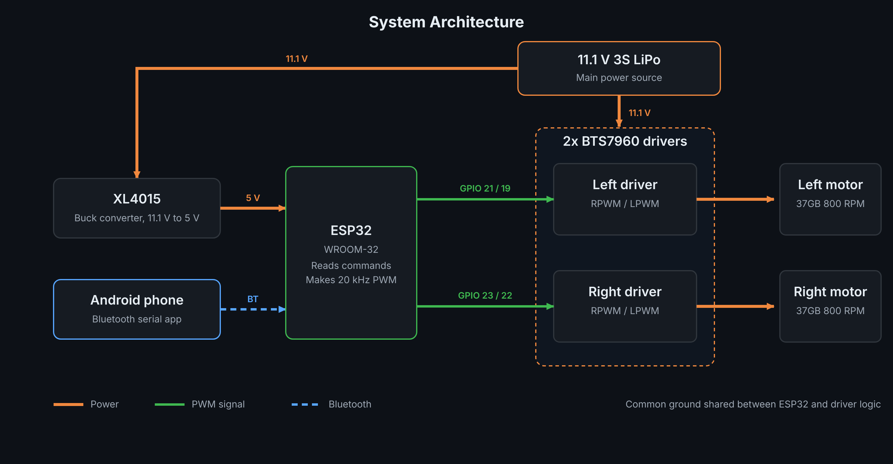
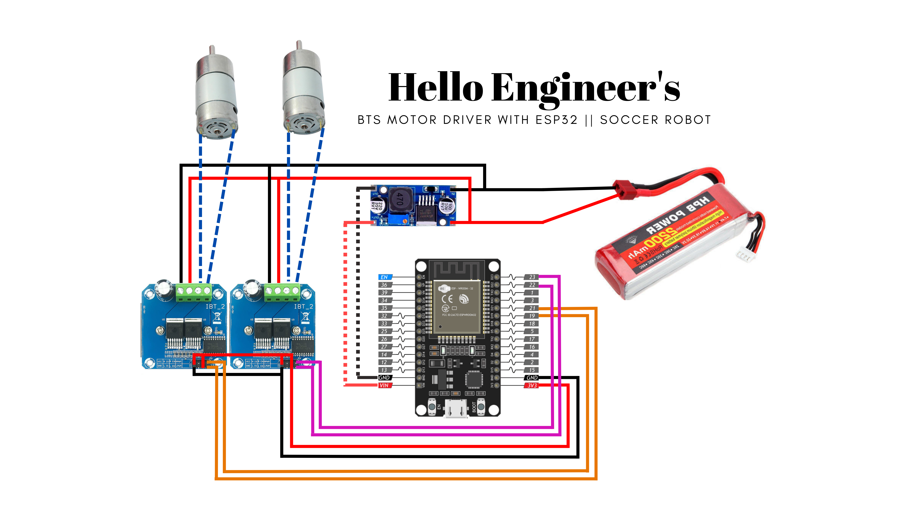

<h1 align="center"> ESP32 Bluetooth Soccer Robot</h1>

  <b>A compact, high-torque robot for robot soccer: ESP32 brain, two BTS7960 drivers, 3S LiPo power, driven from an Android phone over Bluetooth.</b>

  
  
  
  
  
  

  

---

## Table of Contents

- [Overview](#overview)
- [Key Features](#key-features)
- [Hardware](#hardware)
- [System Architecture](#system-architecture)
- [Wiring and Pin Map](#wiring-and-pin-map)
- [Firmware](#firmware)
- [Getting Started](#getting-started)
- [Gallery](#gallery)
- [Competitions](#competitions)
- [Team](#team)
- [License](#license)

---

## Overview

This is a two-motor, tank-style robot built for robot soccer, where pushing power and quick turns count for more than top speed.

An **ESP32** listens for single-letter commands sent from an Android Bluetooth app and converts them into PWM signals for two **BTS7960** motor drivers. The drivers and motors run straight from an **11.1 V 3S LiPo**, while a separate **XL4015** buck converter supplies the ESP32 with a clean 5 V.

It is a team project. The robot has been taken to real competitions, and each one is documented under [Competitions](#competitions).

---

## Key Features

- **Strong drive:** BTS7960 drivers (43 A peak each) fed directly from the battery.
- **Full movement set:** forward, backward, spin left/right, four curved moves and stop.
- **Ten speed levels:** changeable on the fly, even while moving.
- **Quiet motors:** 20 kHz PWM keeps the motors free of audible whine.
- **Bluetooth failsafe:** both motors stop if the phone disconnects.
- **Core 2.x and 3.x support:** the sketch builds on both ESP32 Arduino cores.
- **Separate logic supply:** the ESP32 runs from its own regulated 5 V rail.

---

## Hardware

| Component | Specification | Role |
|:--|:--|:--|
| **Microcontroller** | ESP32 (WROOM-32), Wi-Fi + Bluetooth | Receives commands, generates PWM |
| **Motor drivers** | 2x BTS7960 (43 A peak) | Motor speed and direction |
| **Motors** | 2x 37GB 800 RPM metal gear motors | Drive and pushing power |
| **Battery** | 11.1 V 3S LiPo (high C-rating) | Main power source |
| **Regulator** | XL4015 step-down buck module | 11.1 V to 5 V for the ESP32 |
| **Controller** | Android Bluetooth serial app | Drives the robot from a phone |

---

## System Architecture

  

The full wiring schematic is below.

  

---

## Wiring and Pin Map

| Driver | Function | ESP32 GPIO | BTS7960 pin |
|:--|:--|:--:|:--|
| Left | Forward | 21 | RPWM |
| Left | Backward | 19 | LPWM |
| Right | Forward | 23 | RPWM |
| Right | Backward | 22 | LPWM |
| Both | Enable | n/a | R_EN and L_EN tied to 3V3 |

**Power connections**

- Battery (+/−) goes to both BTS7960 power inputs (B+ / B−) and to the XL4015 input.
- XL4015 output (set to 5 V) goes to the ESP32 VIN and GND.
- ESP32 GND is shared with the BTS7960 logic GND.
- Each BTS7960 output goes to one 37GB motor.

---

## Firmware

The firmware is one Arduino sketch: [`ESP32_Soccer_Robot.ino`](ESP32_Soccer_Robot.ino).

| Setting | Value |
|:--|:--|
| PWM frequency | 20 kHz |
| PWM resolution | 8-bit (0–255) |
| Bluetooth name | `SoccerBot` |
| Library | `BluetoothSerial` |
| Failsafe | Both motors stop when the Bluetooth client disconnects |

**Commands**

| Key | Action |
|:--:|:--|
| `F` / `B` | Forward / backward |
| `L` / `R` | Spin left / right |
| `G` / `H` | Forward-left / forward-right (inner wheel at half speed) |
| `I` / `J` | Backward-left / backward-right (inner wheel at half speed) |
| `S` | Stop |
| `0`–`9`, `q` | Set speed (applies to the last movement command) |

**Speed levels**

| Key | `0` | `1` | `2` | `3` | `4` | `5` | `6` | `7` | `8` | `9` / `q` |
|:--|:--:|:--:|:--:|:--:|:--:|:--:|:--:|:--:|:--:|:--:|
| PWM duty | 0 | 100 | 120 | 140 | 160 | 180 | 200 | 220 | 240 | 255 |

The robot starts at level `5` (180).

---

## Getting Started

1. Install the **Arduino IDE** and the **ESP32 board package**.
2. Open `ESP32_Soccer_Robot.ino` and select your board (for example *ESP32 Dev Module*).
3. Upload the sketch over USB.
4. Wire the robot as in [Wiring and Pin Map](#wiring-and-pin-map) and connect the battery.
5. Pair your Android phone with **SoccerBot** in Bluetooth settings.
6. Open a Bluetooth serial / RC-car app that sends the letters above, connect to `SoccerBot`, and drive.

> ⚠️ For the first power-on test, lift the wheels off the ground.

---

## Gallery

  

  

  

---

## Competitions

Full reports (match notes, failure analysis, lessons and next fixes) are in [`competitions/`](Competitions/).

<!-- To add a competition: copy competitions/_TEMPLATE.md into a new folder, fill it in, then add a row below. -->

| Year | Event | Organizer | Result | Report |
|:--:|:--|:--|:--|:--:|
| 2026 | ROBO LEAGUE 2026 | Robotics Club of BRAC University (ROBU) | Participated, withdrew mid-match after a hardware fault | [Report](Competitions/Robo%20League%2026/README.md) |

---

## Team

| Member | Contribution |
|:--|:--|
| [**Ashraful Shuvo**](https://github.com/iamashrafulshuvo) | Hardware: robot assembly, soldering, wiring of power and driver connections, testing and debugging |
| [**Farhan**](https://github.com/iamfarhan99) | Firmware, control logic and the original team repository |
| **Rahib** | Team member, supported the team during the project |
| **Joya** | Team member, supported the team during the project |

Original team repository: [iamfarhan99/ESP32-based-Soccer-Bot](https://github.com/iamfarhan99/ESP32-based-Soccer-Bot)

---

## License

Released under the **MIT License**. See [`LICENSE`](LICENSE).
